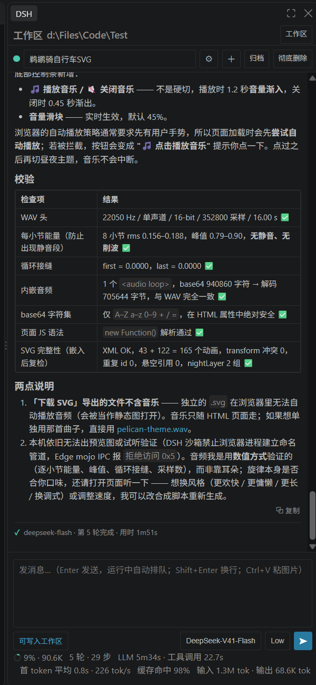
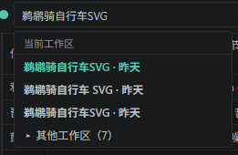
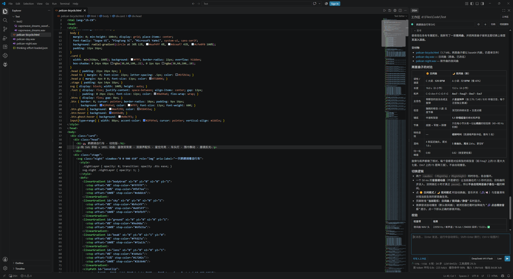
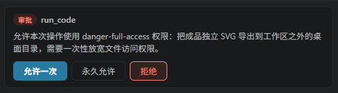
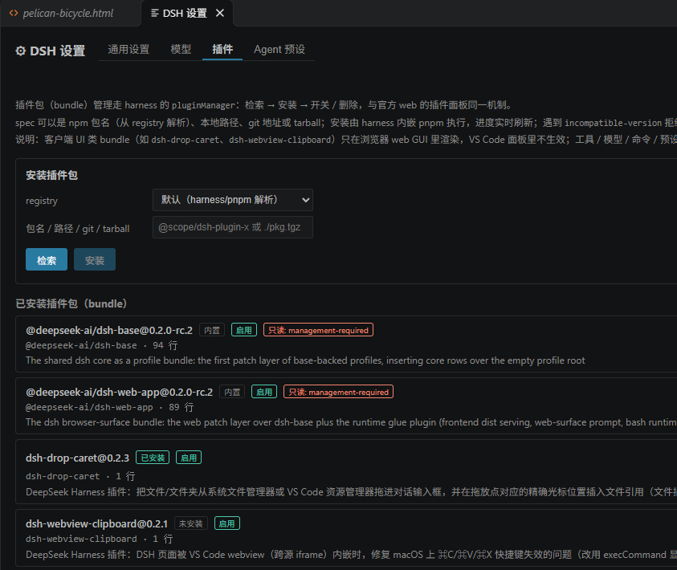
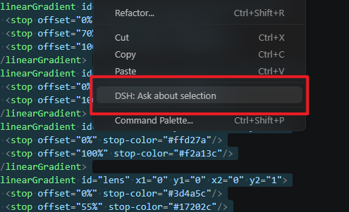
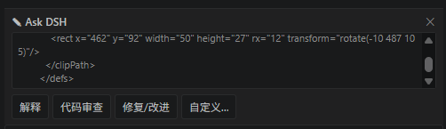

# DSH Bridge · DeepSeek Harness in VS Code

**Run [DeepSeek Harness](https://github.com/deepseek-ai/deepseek-harness) — the local AI agent — inside VS Code.** A native sidebar panel plus an editor bridge that connects to DSH as a **protocol client**: no rewriting DSH, no second server, one shared history with the web GUI.

Read this in: **English** · [简体中文](README.zh.md)

> **Fork notice** — This is a community fork of
> [zhibailu/dsh-vsc](https://github.com/zhibailu/dsh-vsc), maintained by
> [Najabom](https://github.com/Najabom). It keeps the original "pure bridge"
> design and adds: full protocol support for the new DSH (0.1.7-rc.2+ through
> 0.2.0-rc.2), an update center (activation checks, interface preflight,
> one-click update with rollback), Windows sandbox workspace-ACL auto-repair,
> follow-agent-edits, workspace-aware sessions, and a large panel/UX overhaul.
> Original work © 2026 zhibailu (MIT). Per-version history in
> [CHANGELOG.md](CHANGELOG.md).

---


> **TL;DR** — DeepSeek Harness (DSH) is an AI *agent* that lives on your machine (default `http://127.0.0.1:3080`). DSH ships a web UI, but that web UI is just **one client** of DSH's wire protocol. `dsh-vsc` is **another client** — a real VS Code sidebar plus a native editor bridge. It does not rewrite DSH and it does not embed the web UI: it talks the protocol and renders the work in a panel that belongs to VS Code. Same history, same contract, no second server.

---

## Table of contents

- [Why this fork](#why-this-fork)
- [Features](#features)
- [Screenshots](#screenshots)
- [Requirements](#requirements)
- [Installation](#installation)
- [Quick start](#quick-start)
- [How it works](#how-it-works)
- [Design philosophy — "pure bridge"](#design-philosophy--pure-bridge)
- [Built-in companion plugin](#built-in-companion-plugin)
- [Commands](#commands)
- [Configuration](#configuration)
- [Limitations & deliberately out of scope](#limitations--deliberately-out-of-scope)
- [Development](#development)
- [Documentation](#documentation)
- [Contributing](#contributing)
- [License](#license)

---

## Why this fork

Upstream `zhibailu/dsh-vsc` (0.2.6) targets the DSH era of 2026-09. This fork tracks the **new DSH protocol** and turns the panel into a first-class daily driver:

- **Full protocol support for the new DSH** (0.1.7-rc.2+ through 0.2.0-rc.2): typert RPC gateway, the multiplexed event socket, waterfall approvals & questions, paginated history, per-session projections.
- **Update center**: checks for new DSH versions on activation and every 6 hours; before updating, it *preflights* the new version (official release-notes scan + a static interface check of the new package) and recommends updating the extension first when an interface it relies on is at risk; after updating, it restarts the harness and verifies communication — with one-click rollback if the self-test fails. Installs are hardened: peer conflicts retry with `--force`, a lagging registry mirror falls back to the official npm registry, and half-published versions are caught by a dependency preflight. The settings page has **check / install** buttons for both DSH and the extension itself.
- **Workspace-aware**: the harness runs in your opened folder; sessions are grouped by workspace; a workspace strip keeps you oriented; one button switches the folder.
- **Windows sandbox friendly**: auto-repairs the directory permission the DSH sandbox needs (workspace ACL), prompting for a one-time elevated fix only when it truly cannot do it alone.
- **Follow agent edits**: when DSH edits a file, the editor opens it and the cursor lands on the first changed line — covering direct file tools *and* nested PTC dispatches, plus files written on disk by other means (e.g. shell commands) while a turn runs, captured by a workspace file watcher.
- **Quality-of-life**: session hard-delete, archiving, "always allow" approvals, plan mode, Chinese context menu, per-turn model label, status-bar fallback entry (when the activity-bar icon is hidden), a modern status row (context usage, live tok/s, cache stats), unified control sizing, opencode-style output coloring.

## Features

**Native sidebar panel**

- Streaming replies; collapsible **reasoning**; per-turn summary with the **model used** and elapsed time.
- Tool actions with tone colors (exec / read / write / agent) and `+N-M` change stats per turn.
- **Approval cards** — allow once / deny / **always allow** (the third answer raises the session permission to the escalated mode, so similar operations stop asking).
- **Question cards** — single choice (number keys), multi-select, recommended badge, custom answer with ↑↓ recall, skip.
- **Session modes** (standard / PTC / minimal / cordis), **reasoning effort**, and **permission presets** (read-only / workspace-write / danger-full-access) — one click from the composer.
- **Plan mode** — a plan toggle right of the permission button: *plan* (soft guidance) or *plan + lock read-only*. Entering and exiting is a session command; exiting restores the permission preset you had before. Plan-review questions render the plan as a formatted card with **Approve and exit plan mode** / **Keep planning** — the answer still travels verbatim, so DSH's own approval check stays intact.
- **Account balance** — right of the plan toggle: the signed-in DeepSeek-account wallet as plain read-only text (CNY first, two-decimal display, slightly bold; hover for bonus detail; auto-refreshes after each turn and whenever the panel opens).
- **Task-list records** — every `todo_write` snapshot stays in the transcript as an expandable card, so a list wiped by an interruption is never lost.
- **Agent team panel** — with the official *agent team* bundle enabled, a **team** button (member count) opens the live team card: members (lead first, running / idle / starting / failed, model, error detail) and shared tasks (status marks, owner, blocking, write scopes, expandable descriptions). Click a teammate to open its **continuable session** in the panel — chat with it, stop it, and jump back to the lead. Mirrors the official web team dialog, read-only tasks included.
- **Composer takeover**: the input bar locks while the agent is asking, so you can't send mid-question. Dismissing a question card submits a completed batch of skipped answers (the official skip semantics), so the agent carries on instead of thinking the question never arrived.
- **Attachments** — paste or drop images straight into the composer (sent inline exactly like the web UI); drop documents from the system or the Explorer (or pick them with 📎) to send them as durable file references. A draft rail shows thumbnails and sizes (click a thumbnail for the lightbox), and attached images render in the transcript.
- **Browser tools** — the companion plugin's `page_screenshot` renders page images **in the chat** (the model actually sees them) and `page_eval` runs render assertions — sandbox-proof, see [Built-in companion plugin](#built-in-companion-plugin).
- Bookkeeping messages (runtime context, model-change notices) are hidden — the transcript keeps what you and the agent actually said.

**Sessions & workspaces**

- The session picker groups conversations by workspace: current-workspace sessions up front (active one bold), other workspaces behind an expandable **“其他工作区”** toggle.
- The **workspace strip** above the picker shows the current folder; the **workspace button** on its right switches folders (new sessions land there).
- The panel auto-opens a conversation only from the **current** workspace; other folders' sessions stay in the picker, one click away.
- **Archive** and **permanent delete** (removes the session's history files under `~/.dsh/sessions`).

**Native editor bridge**

- **Ask DSH about a selection** — select code → right-click → *DSH: Ask about selection* (localized), with a structured context card (file / selection / workspace / branch). The ask lands in the workspace's own **question-conversation window** (side editor split), so questions never interleave with the coding chat; its session title stays pinned to 「问题对话」 (official rename), and the window carries full send / ✕-stop controls.
- **Review Agent Changes** — per-turn changed-file list → native VS Code **git diff** in one click.
- **Follow agent edits** — auto-open + first-changed-line cursor (preview tab, no focus steal); also catches external writes (e.g. `pwsh`) while a turn runs; toggle with `dshVsc.followAgentEdits`.
- **Nested tool calls at a glance** — shell/fs calls inside a `run_code` program (`pwsh`, `read`, `write`, …) render as indented ↳ sub-cards with args, result and live timing, bundled with their parent card.
- **Honest turn outcomes** — a turn that ended with an error (quota exhaustion, auth failure, timeout, interruption) is marked failed in the transcript with the raw error message and HTTP status, never a green “completed”. Quota failures add a top-up link; failed turns also raise one VS Code notification (`dshVsc.notifyTurnFailures` opts out).

**Update center**

- On activation and every 6 hours while a window stays open, checks npm for a newer DSH; offers **update now / later** (the skip is remembered until the next version).
- **Channel-aware**: follows the installed build by default (`auto`) — a `0.2.1-rc.x` installation tracks the newest prerelease instead of comparing against the stale `latest` tag; choose `stable` / `next` / `alpha` explicitly with `dshVsc.dshUpdateChannel`.
- **In-editor update center**: the settings page *General* tab has **check / install** buttons for both the DSH package and the extension itself (the extension downloads the GitHub release VSIX and installs it through the VS Code CLI; the running window keeps working until a reload).
- **Interface preflight** before updating: scans the official release notes between your version and the new one for the interfaces this extension uses, and statically verifies them inside the new package tarball. If an interface is at risk → warns and suggests **updating the extension first**; an escape hatch (*update anyway, auto-rollback on self-test failure*) remains available.
- After updating: restarts the harness, reconnects the streams, verifies RPC + event stream; on failure offers a **rollback** to the previous version.

**Plugin & model management** (settings page: General / Models / Plugins / Agent presets)

- **Model picker** with reasoning effort; channels (official / account) are whatever DSH routes.
- **Plugin manager** — search & install from the registry, enable/disable, remove; an `incompatible-version` refusal can be answered with a **version exemption** (explicit risk acknowledgement), and pending-build approvals are surfaced for confirmation.
- **Official optional bundles, first-class** — the plugins page groups every official experimental bundle (agent team, voice input, auto review, inspector, session search / titles, terminal, ralph, badge skills, CoT translation, worktrees, plugin market) and enables them straight from the installation copy — no reinstall, no hand-edited profile. On-demand subagent providers (Codex, Claude Code) install from their pinned spec; updates are offered when an installed bundle is behind; a lost install response can be recovered with *check install status*; built-in modules are listed by agent preset.
- **Plugin market** (opt-in) — enable the official *plugin market* bundle and the plugins page gains index management plus search / install / update from the marketplace, with the same compatibility and version-exemption safeguards.
- **MCP servers** are configured inside DSH's own profile (its `cordis.yml`); DSH exposes no RPC for them, so the extension deliberately does not manage them.
- **API & custom providers** — settings page *API* tab: per-provider API keys (environment variable or DSH credential store — set and clear), and one-click custom-provider creation (route, display name, protocol, base URL, model list + *discover models*); saved providers join the session model catalog immediately.

**Harness lifecycle**

- Reuses a running DSH (shared client — **never a second server**); auto-starts its own windowless instance only when none is reachable. That instance is **owned**: a manually started harness is never touched.
- **Multiple VS Code windows** share the one harness. Every window writes a small heartbeat; closing one of several windows leaves the service running for the others, closing the **last** window stops it. If every window dies at once (crash / force-kill), a guard wrapper in front of the harness kills the tree ~45 seconds later — a background instance can never be orphaned.

## Screenshots

**Sidebar** — native DSH panel: workspace strip, session picker, streaming reply, per-turn model & timing, live status row (context ring, throughput, cache hits)

<p align="center"></p>

**Sessions grouped by workspace** — the current workspace's conversations stay on top (bold); everything else folds under *Other workspaces (N)*

<p align="center"></p>

**Follow agent edits** — files DSH writes open automatically with the cursor at the first changed line (preview tab, focus stays where you are)

<p align="center"></p>

**Approval card** — allow once / **always allow** (answers once and raises the session preset) / deny

<p align="center"></p>

**Settings → Plugins** — search, install, enable/remove bundles; version exemptions and build approvals handled inline

<p align="center"></p>

**Ask about selection** — right-click selected code → *DSH: Ask about selection* (menu titles follow your VS Code language)

<p align="center"></p>

**Ask card** — the structured context card in the panel: explain / review / fix / custom

<p align="center"></p>

## Requirements

- **VS Code `^1.90.0`** — Windows / macOS / Linux.
- **DSH installed globally**: `npm i -g @deepseek-ai/dsh` (0.1.7-rc.2 or newer; tested through 0.2.0-rc.2). The extension reuses a running `dsh web` or auto-starts its own instance on the same port and the same history (`~/.dsh`) — one history, never a second server. If DSH is missing, the “DSH Bridge” output channel tells you what to install.
- **API keys live in DSH's credential store** (managed from the extension's settings page *API* tab; an environment variable always wins). Account sign-in stays on the DSH side (`dsh web` browser login).
- **Windows**: the workspace-write sandbox needs the workspace folder to be *grantable* (the sandbox writes a low-integrity label, which requires full control). The extension repairs this automatically (`dshVsc.autoFixWorkspaceAcl`) and asks for a one-time elevated fix only when it cannot.

## Installation

**Option A — Release package (recommended)**

1. Download the latest `dsh-vsc-<version>.vsix` from [Releases](https://github.com/Najabom/dsh_vsc_refresh/releases).
2. Install it (VS Code `Ctrl+Shift+P` → **Install from VSIX**, or command line):

   ```bash
   code --install-extension dsh-vsc-<version>.vsix --force
   ```

3. Reload the window (`Ctrl+Shift+P` → **Reload Window**), then click the **DSH** icon in the left activity bar.

> Default harness URL `http://127.0.0.1:3080`; overridable with the `dshVsc.url` setting or the `DSH_WEB_URL` environment variable.

**Option B — from source**

```bash
git clone https://github.com/Najabom/dsh_vsc_refresh.git
cd dsh_vsc_refresh
npm install
npm run package        # esbuild build + vsce package → dsh-vsc-<version>.vsix
code --install-extension dsh-vsc-<version>.vsix --force
```

## Quick start

1. **Reload the window** — required after install.
2. Click the **DSH** icon in the left activity bar to open the sidebar.
3. If DSH isn't installed yet, run `npm i -g @deepseek-ai/dsh` once (see [Requirements](#requirements)); the extension then starts and owns its windowless harness (or reuses a running one).
4. Send a message and watch the agent work. Approvals and questions show up as cards in the panel; file edits can auto-open in the editor (follow agent edits).

## How it works

DSH exposes a **typert RPC gateway** (`POST /api/<endpoint>` with `{type:"client-request", rpcId, method, payload:{args}}` envelopes) and a **multiplexed event socket** (`/api/remote.mux`, a WebSocket carrying logical streams: the global `$events` stream, per-session `session/control`, `workspace/follow`, `session/follow`). The web GUI is one consumer of that contract; this extension is another.

- **`src/harness/client.ts` — a <300-line minimal protocol client.** It reimplements the wire contract in Node (≥ 18, global `fetch`; `ws` for the socket), imports **no** DSH internals, and stays deliberately thin — it implements the protocol, not the plugin framework. Endpoints cover sessions, history paging, prompts, models, permissions, plugins, and account state.
- **Lossless events.** The panel receives the **raw frames** from the event streams with no re-modeling; rendering is the panel's job. The bridge stays transparent, so it can't drift from DSH's semantics.
- **Waterfall questions.** Approvals and user questions arrive on the `$events` stream (`approval/request`, `user-questions/request`); the answer is posted back to `$events/result` carrying the **clientId from the stream's ready frame** and the event id. Get that bookkeeping wrong and the gateway rejects the answer — a bug this fork fixed and now covers with tests.
- **Protocol-first, UI-agnostic.** DSH's official README notes there is *no protocol version field because client and host ship together* — until an independently released client exists. This extension is exactly such an independently released client, standing on the stable **contract** layer rather than the volatile **UI** layer — it survived DSH 0.1.7 → 0.2.0 protocol evolution with the adaptation contained in the client/mapping layer.
- **Browser auth, handled both ways.** DSH 0.1.7-rc.2 introduced process-level browser-token auth for `/api` and the event socket. A **native `dsh web`** launched by you is joined, not asked to shut down: the extension mints a short-lived browser-session cookie from this machine's persistent browser-session secret (`~/.dsh/.credentials.yaml`; loopback addresses only, never logged; `dshVsc.nativeWebAuth` opts out). Instances the extension starts itself get a single **in-memory delta** that bypasses the browser-auth check, with three safety rails: it mutates only loaded memory (official files stay byte-identical on disk), it **verifies SHA-256** of the official files and bails entirely on mismatch, and it checks **canary anchors** before patching, degrading gracefully on any failure. Degraded mode surfaces visibly (“API 拒绝访问” with a hint to update the extension). It has an explicit retirement path: when DSH offers a supported headless/service auth, the delta is deleted.
- **Second client, never a second server.** A real incident showed two DSH processes sharing `~/.dsh` corrupt each other's history (`corrupt session log: seq gap`). So the extension never starts a second server on an existing history: it reuses a live harness, auto-starts its own only when none is reachable (taking the same default port, so the two can never co-write), and stops that owned instance deterministically when VS Code exits — a shared harness is left alone.

A full, reader-friendly deep-dive — written for someone who doesn't know the domain — lives in [docs/design.md](docs/design.md).

## Design philosophy — "pure bridge"

> **I don't take DSH's job; I'm its best client.**

- **Don't rewrite DSH** → stays byte-identical; its stability is yours, its upgrades don't force you to rewrite.
- **Don't copy DSH's UI framework** → re-implementing a plugin system neither flatters DSH nor helps you.
- **Don't start a second DSH** → two processes sharing one history corrupt each other.
- When you *must* patch (overlay), make it **verifiable and degradable** — verify, guard with canaries, fail safe, retire when upstream catches up.

## Built-in companion plugin

The VSIX ships a small DSH plugin (`dsh-vsc-companion`, source in [`companion/`](companion/)) and the extension **installs and keeps it updated in your DSH profile automatically** — no manual configuration, no profile editing. It adds two capabilities that the plain protocol cannot provide:

- **Live task lists.** DSH injects todos only into *its own* UI, so the model tends to batch-update its checklist at the very end of a task. The companion feeds a **live checklist snapshot** into every request's runtime context, with the increment discipline spelled out ("the moment a step finishes, update it — don't batch"), and after an interruption it reminds the model to **rebuild the list before continuing**. Toggle with `dshVsc.companion`; status is shown on the settings *Plugins* tab.
- **Host-side browser tools** (`page_screenshot`, `page_eval`). Sandboxed shells on Windows cannot start a browser (the sandbox forbids the named-pipe/mojo machinery Chromium needs), so visual checks fail inside the command sandbox. These tools run **in the harness host process** instead: `page_screenshot` renders a workspace HTML file (or URL) with your installed Edge (playwright-core, channel `msedge`; falls back to the Edge headless CLI) and returns a PNG — written into the workspace *and* attached to the tool result as an **image the model can see**; `page_eval` runs a JS snippet inside the page and returns JSON plus captured console output.

The plugin is an ordinary, removable DSH bundle: it shows up in **Settings → Plugins** like any other, `removeBundle` removes it, and DSH's version-exemption flow applies if a future DSH ever refuses it.

## Commands

| Command | What it does |
|---|---|
| `DSH: Open Sidebar` | Focus the DSH sidebar |
| `DSH: Start Web Harness` | Start/connect the harness explicitly |
| `DSH: Stop Auto-started Harness` | Stop only the instance *this* extension started; never a shared one |
| `DSH: Refresh Connection Status` | Re-probe the harness |
| `DSH: Open Web GUI (advanced)` | Open the official DSH web GUI as a tab — same harness, same history |
| `DSH: Ask about selection` | Ask DSH about the selected code (also in the right-click menu) |
| `DSH: Review Agent Changes` | Open a native git diff of the files the agent changed |

> Titles are localized (`package.nls`): command palette and context-menu entries follow the VS Code display language (the table shows the default English).

## Configuration

| Setting | Default | Description |
|---|---|---|
| `dshVsc.url` | `http://127.0.0.1:3080` | Base URL of the DSH harness. Also honors `DSH_WEB_URL`. |
| `dshVsc.autoStart` | `true` | Auto-start the harness when no instance answers at the configured URL. |
| `dshVsc.followAgentEdits` | `true` | Open files in the editor (preview tab, cursor on the first changed line) as the agent edits them; covers direct file tools and nested PTC dispatches. |
| `dshVsc.companion` | `true` | Ship/auto-install the built-in `dsh-vsc-companion` DSH plugin (live task-list discipline + host-side `page_screenshot` / `page_eval`). |
| `dshVsc.autoFixWorkspaceAcl` | `true` | On opening/switching a workspace, auto-grant the directory permission the Windows sandbox needs; if it cannot, offer a one-time elevated fix. |

## Limitations & deliberately out of scope

- No rewritten chat UI, no event truncation/whitelisting; account sign-in stays on the DSH side (API keys are written through to DSH's credential store from the settings page).
- No second harness — reuse first, auto-start only when none exists; the owned instance stops with VS Code, a manually started one is left running.
- Change tracking & follow-edits cover the file tools (`write` / `edit` / `apply_patch` / `str_replace_editor`) including their nested PTC dispatches; while a turn runs, files written on disk by anything else (e.g. `pwsh` scripts) are captured by a workspace file watcher and count into the changed-files badge the same way.
- The `+N-M` counter is exact for those file tools; external writes are counted at file granularity (the badge lists them, per-file line counts come from the tool metadata only).
- Ask-about-selection opens the workspace's dedicated **question-conversation window** (side editor split); every later ask in that workspace reuses the same conversation; the title is pinned to 「问题对话」 and the window can send or ✕-stop turns directly.
- Approval/question cards replay when you switch back to a session that is waiting on you (the agent stays blocked until answered).

## Development

```bash
npm install
npm run typecheck   # tsc --noEmit (both configs)
npm run build       # esbuild → dist/extension.js + dist/media
npm run package     # build + package vsix
```

F5 debug via [`.vscode/launch.json`](.vscode/launch.json) → Extension Development Host.

Automated regression test (jsdom simulates the webview, feeds real event streams to verify panel rendering):

```bash
node scratch/auto-test.mjs <sessionId> <turnNo>
```

## Documentation

- [Design & architecture rationale](docs/design.md) — why the "pure bridge" approach, the new DSH protocol in plain words, how the overlay is guarded, and how the updater/sandbox/follow-edit mechanisms work.
- [Source map](src/README.md) — what lives where in `src/`.
- [`llms.txt`](llms.txt) — machine-readable doc index for LLM / AI crawlers.
- [`AGENTS.md`](AGENTS.md) — onboarding guide for AI coding agents working in the repo.
- [Changelog](CHANGELOG.md) — release history.

## Contributing

See [CONTRIBUTING.md](CONTRIBUTING.md). We welcome issues, PRs, and docs improvements — especially anything that clarifies the architecture for newcomers.

## License

MIT © 2026 zhibailu (original project) — fork maintained by [Najabom](https://github.com/Najabom). See [LICENSE](LICENSE).
